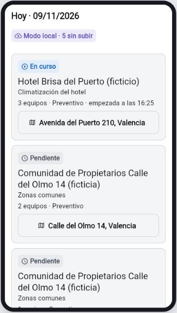
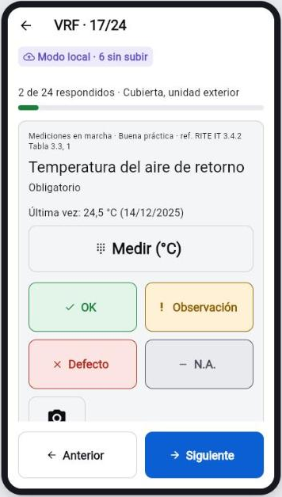
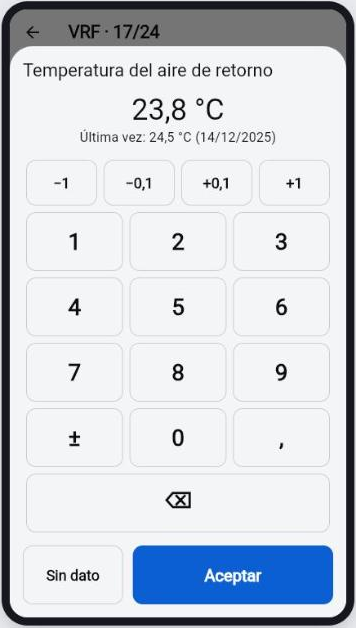
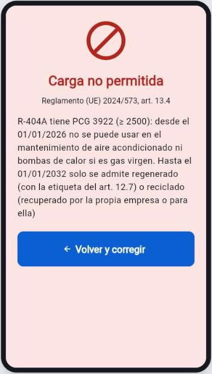
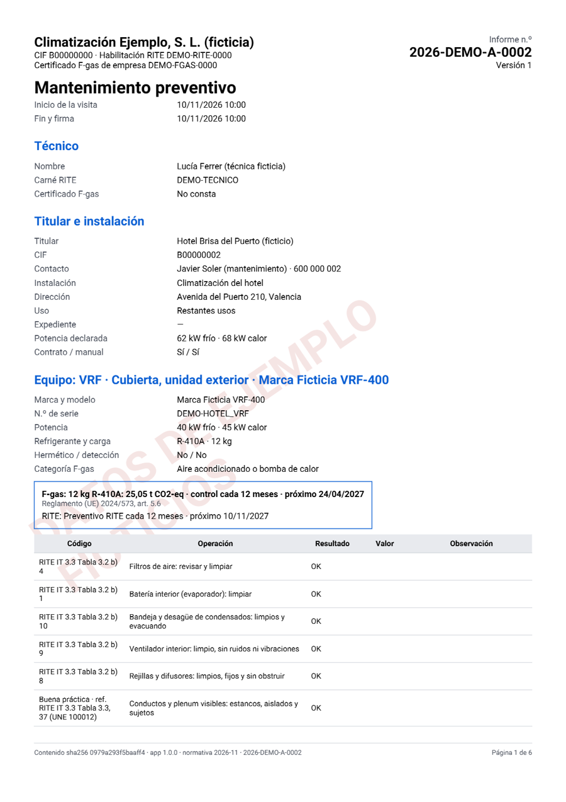
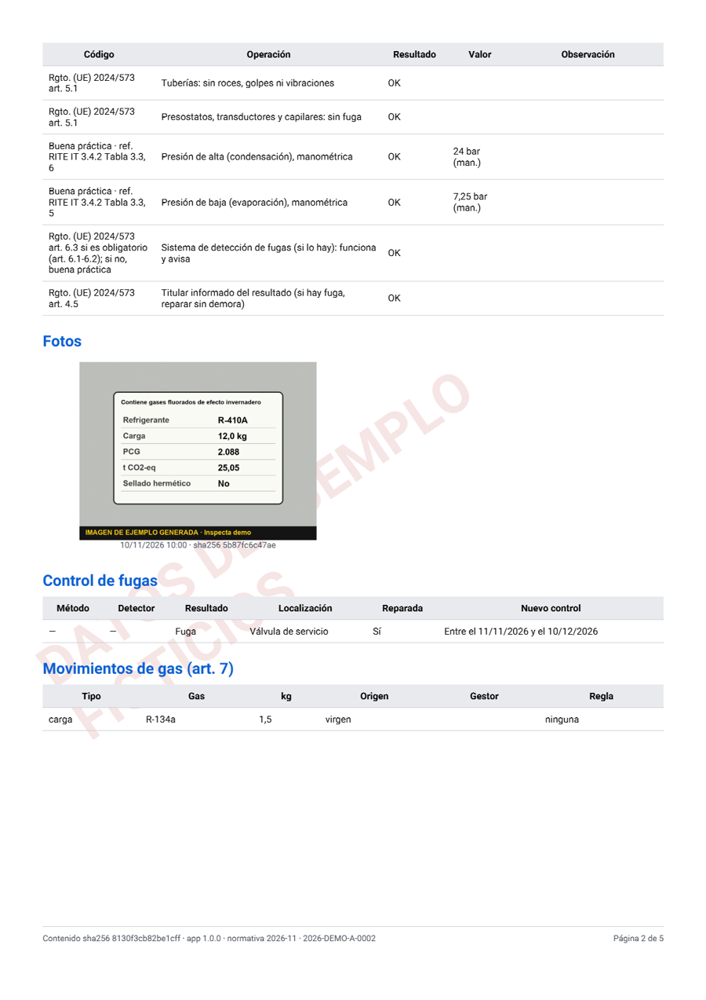
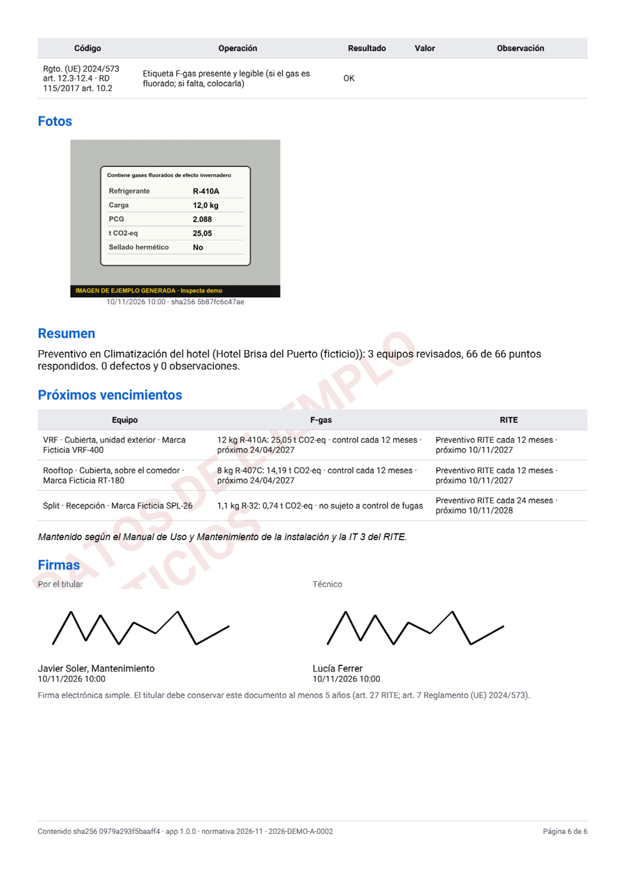
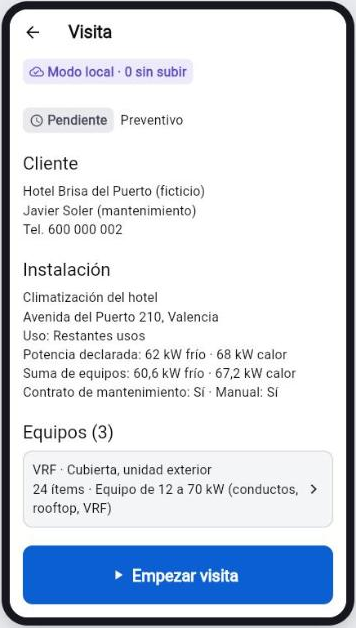
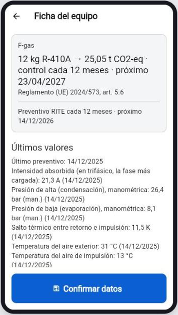
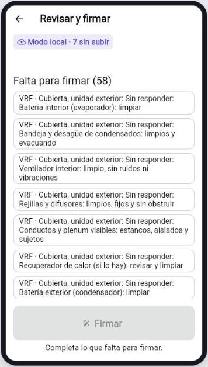

# Inspecta

**Partes e inspecciones de climatización para técnicos de mantenimiento, también en un sótano sin cobertura.**

App Flutter (Android y web) para empresas mantenedoras de climatización en España. El técnico hace la visita entera sin red: checklist RITE con guantes, fotos, registro de gases fluorados con las reglas del Reglamento (UE) 2024/573, firma del cliente y un **informe PDF que se genera en el propio móvil**. Todo queda en una base local (Drift/SQLite) y en una cola de salida lista para sincronizar con Supabase cuando vuelva la red.

> **Estado: en desarrollo (día 7 de un plan de 15).** Lo que se ve aquí funciona de verdad y está probado; la sincronización con Supabase, la IA (Gemini) y el panel de oficina vienen después. Ver [qué funciona hoy](#qué-funciona-hoy) y [qué falta](#qué-falta).
>
> Demostración técnica con **datos inventados**. No es un producto certificado.

<p align="center">
  
  
  
  
</p>

## Muestras

- **Informes PDF generados por la app sin red** (con marca de agua de datos ficticios):
  [preventivo de un hotel](docs/muestras/informe_preventivo.pdf) ·
  [control de fugas con fuga reparada y carga de gas](docs/muestras/informe_control_fugas.pdf)
- Las capturas son de la demo web compilada (`INSPECTA_DEMO=true`) en un marco de móvil.

<p align="center">
  
  
  
</p>

## El problema

Las mantenedoras de climatización hacen a diario revisiones obligatorias (RITE) y controles de fugas de gases fluorados, muchas veces en azoteas y salas de máquinas sin cobertura. El parte acaba en papel o en apps que necesitan red, las periodicidades y los plazos se calculan a mano, y desde el 1 de enero de 2026 cargar gas virgen de PCG ≥ 2.500 en un aire acondicionado está prohibido (art. 13.4 del Reglamento 2024/573). Un error ahí es una sanción para la empresa.

## Qué funciona hoy

| | |
|---|---|
|  | **Visita sin red.** Hoy → orden → *Empezar visita*: la hora queda sellada y la orden pasa a «En curso» al instante, sin esperar al servidor. Se ven el cliente, la instalación con su potencia declarada frente a la suma de sus equipos, las incidencias abiertas de visitas anteriores («Resuelta en esta visita») y se pueden dar de alta equipos en campo con la **plantilla sugerida** por tipo, potencia y uso. |
|  | **Checklist para guantes.** Un ítem por pantalla, botones de 72 dp con icono, texto y color, avance automático y *Deshacer* de 5 s en vez de diálogos. Cada ítem cita su código normativo y enseña el último valor medido en ese equipo, aunque sea de hace un año. Se reanuda donde se dejó. Una prueba automática recorre las pantallas y **falla si algún objetivo táctil mide menos de 56 dp**. |
|  | **Las cifras normativas las calcula el código, no la IA.** t CO2-eq, sujeción y periodicidad del control de fugas (art. 5), próximo control, nuevo control tras reparar una fuga (art. 4.5) y próxima revisión RITE medida con la **potencia de la instalación** (diez splits de 10 kW en un hotel son una instalación de 100 kW). Todo sale de datos versionados en `assets/normativa/`, con pruebas de tabla en los casos frontera. |
|  | **Bloqueo del art. 13.4 a pantalla completa.** Una carga de gas virgen de PCG ≥ 2.500 en aire acondicionado no se guarda (doble barrera: pantalla y repositorio). Con gas reciclado o regenerado se piden los datos de su origen; en refrigeración, solo aviso del art. 13.3. |
|  | **Revisar, firmar y PDF en el móvil.** Lo obligatorio sin responder y las fotos que faltan bloquean, y cada pendiente lleva a su ítem. Resumen automático editable, firma del cliente y del técnico con el dedo, **número correlativo por aparato** (`2026-DEMO-A-0002`), PDF de 11 apartados con fuente incrustada generado en un isolate, y huellas SHA-256 del contenido y del fichero. Lo firmado ya no se puede tocar. |

**Arquitectura offline-first.** Cada escritura va a SQLite y a una cola de salida en la misma transacción; ninguna pantalla espera a la red. La cola respeta el orden que exigirá el servidor: el fichero antes que la fila que lo anuncia, los hijos antes que el cierre, y el cierre firmado siempre el último. Los bytes de fotos y firmas no viajan en la cola, solo su ruta. El estado de la orden y el historial de cada equipo se derivan en local con la misma lógica que tendrán los triggers del servidor.

**Pruebas.** 430 pruebas en verde (`fvm flutter test`): normativa F-gas y RITE con casos frontera, plantillas y sus ids deterministas, esquema y migración de Drift, ida y vuelta Drift↔PostgREST de las 26 tablas sincronizadas, cola de salida, repositorio (visita, checklist, gas, firma, cierre y hash), PDF y flujos de pantalla a 360 dp con objetivos táctiles de 56 dp.

## Qué falta

Según el [plan](docs/DISEÑO.md#12-plan-de-trabajo-por-días-15-días-hábiles):

- **Sincronización con Supabase**: esquema SQL con RLS multiempresa, triggers de candado y de cierre, `SyncEngine` push→pull→reconcile y banco de pruebas SQL de aislamiento entre empresas.
- **IA con Gemini** detrás de Edge Functions (la clave nunca va en la app): leer la placa, proponer incidencias en fotos y pasar notas de voz a campos. **La IA propone y el técnico confirma**; toda decisión queda registrada.
- **Panel web de oficina**: tablero del día, órdenes e informes firmados.
- Notas de voz, GPS, comprobación de nitidez de las fotos y ajustes del aparato.

## Normativa y límites

La lógica cita el RITE (RD 1027/2007, IT 3) y el Reglamento (UE) 2024/573. Lo que no está verificado se marca **[A VERIFICAR]** en el código y en [`docs/DISEÑO.md`](docs/DISEÑO.md) en vez de inventarlo; por ejemplo, si el umbral de 70 kW se mide con frío, con calor o con la mayor (hoy se usa la mayor, que es lo prudente), o los gases del anexo II (HFO puros), que no se calculan y lo dicen. Los textos de las plantillas y la verosimilitud de cargas y potencias de la demo están pendientes de revisión por un técnico mantenedor.

## Cómo ejecutarlo

Flutter 3.47.9 fijado con [FVM](https://fvm.app):

```bash
fvm flutter pub get
fvm flutter test
fvm flutter run -d chrome --dart-define=INSPECTA_DEMO=true
```

La demo web funciona en Chrome de escritorio (usa SQLite compilado a WebAssembly en un worker). El APK de Android con los mismos datos se compila con `fvm flutter build apk --dart-define=INSPECTA_DEMO=true`.

## Decisiones técnicas

- **Drift (SQLite) como fuente de verdad en el móvil** y una cola de salida propia en vez de un SDK de sincronización: el orden de subida es parte de la lógica de negocio (un informe firmado no puede llegar antes que sus fotos).
- **El PDF se genera en el aparato** y es el canónico: el técnico entrega el informe en la azotea, sin red, y su hash ya no cambia.
- **La normativa son datos versionados**, no constantes: cuando cambie una cifra, cambia un JSON con su prueba, y cada informe guarda con qué versión se calculó.
- Diseño completo, decisiones y riesgos en [`docs/DISEÑO.md`](docs/DISEÑO.md).

## Autor

Pau Viejo Herrero, también autor de Forja (app Flutter en Google Play), de la que viene la base de la cola de salida.

---

*English:* Inspecta is an offline-first Flutter app (Android and web) for HVAC maintenance technicians in Spain. A full inspection works without network: glove-friendly checklist, photos, F-gas rules from Regulation (EU) 2024/573 computed in code (with the art. 13.4 ban enforced), customer signature and a PDF report generated on the device. Supabase sync, Gemini-based assistance and the office dashboard are next. All data shown is fictitious.

© 2026 Pau Viejo Herrero. Todos los derechos reservados.
